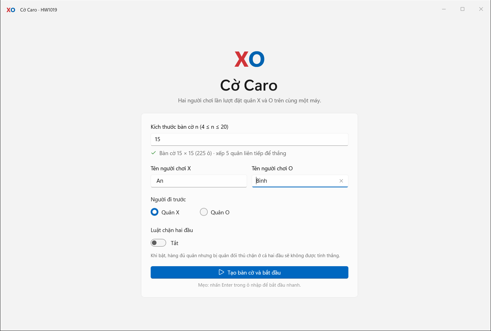
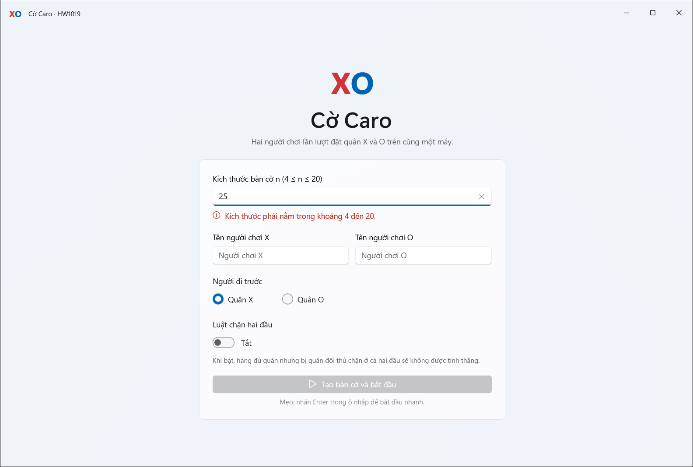
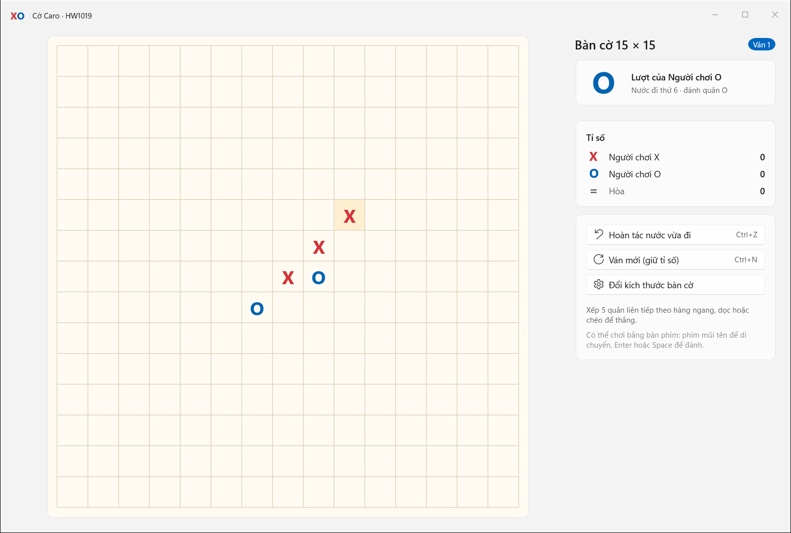
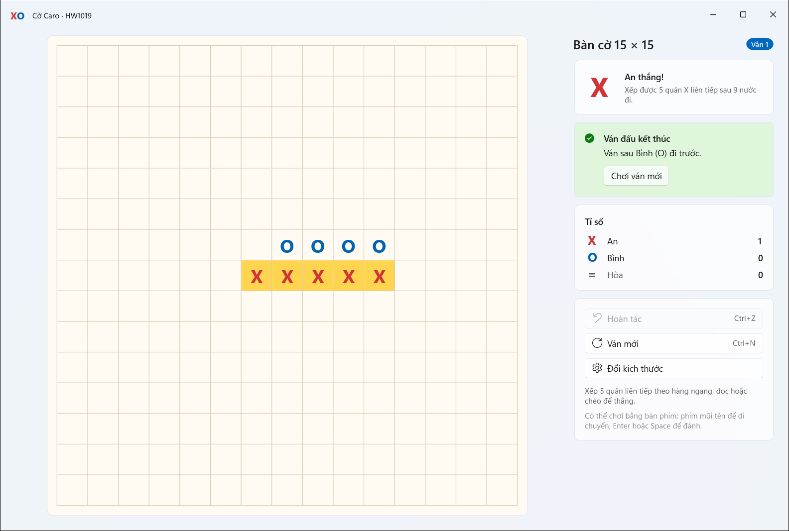
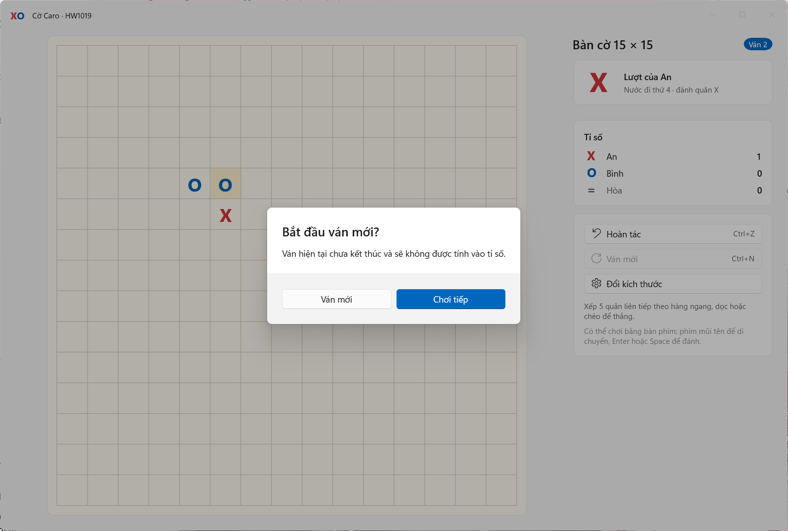
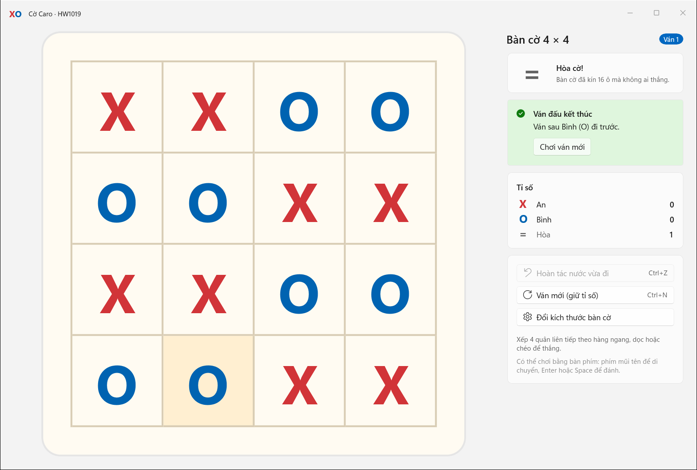
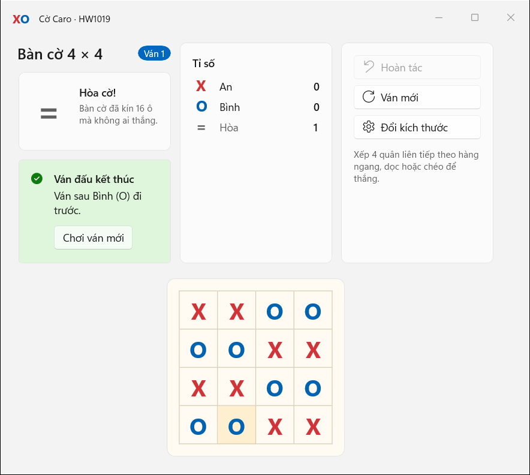
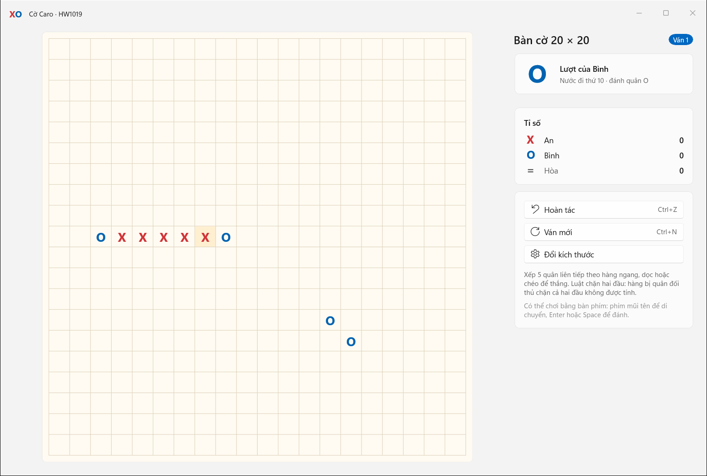
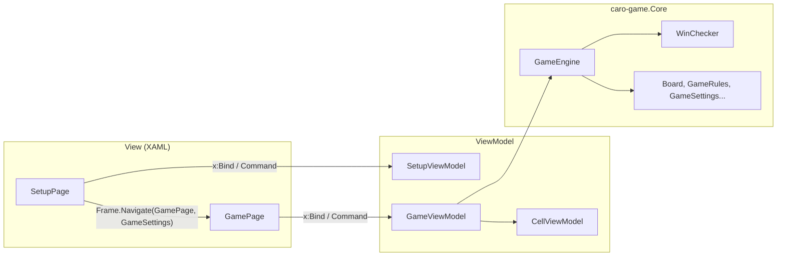

# HW1019 – Trò chơi cờ caro (WinUI 3)

| Thông tin | Nội dung |
| --- | --- |
| Sinh viên | **Trần Kim Yến** |
| MSSV | **23120193** |
| Môn học | Lập trình Windows |
| Bài tập | HW1019 – Trò chơi cờ caro |
| Công nghệ | C#, XAML, WinUI 3, Windows App SDK, MVVM, xUnit |

> **Đề bài:** Cho người dùng nhập vào kích thước bàn cờ (4 <= n <= 20), tạo ra bàn cờ và cho phép hai người chơi cờ caro với nhau.

Ứng dụng WinUI 3 (đóng gói MSIX) cho hai người chơi cờ caro trên cùng một máy. Người chơi nhập kích thước `n`, ứng dụng kiểm tra `4 ≤ n ≤ 20`, tạo bàn cờ `n × n` rồi cho hai bên lần lượt đánh X và O. Ứng dụng tự phát hiện thắng (đủ quân liên tiếp theo hàng ngang, dọc, chéo) hoặc hòa (kín bàn), tô sáng hàng thắng và ghi tỉ số qua nhiều ván.

**Kết quả đã kiểm tra:** build Debug/x64 và Release/x64 (có trimming) thành công, không lỗi và không cảnh báo; 60/60 unit test đạt; chạy ứng dụng trong context gói MSIX và kiểm tra tự động các luồng chính bằng UI Automation, có ảnh chụp minh chứng. Chi tiết trong [docs/TESTING.md](docs/TESTING.md).

## Mục lục

- [Ảnh chụp màn hình](#ảnh-chụp-màn-hình)
- [Đối chiếu yêu cầu đề bài](#đối-chiếu-yêu-cầu-đề-bài)
- [Tính năng](#tính-năng)
- [Luật chơi](#luật-chơi)
- [Công nghệ và môi trường](#công-nghệ-và-môi-trường)
- [Mở, build và chạy](#mở-build-và-chạy)
- [Cấu trúc mã nguồn](#cấu-trúc-mã-nguồn)
- [Kiến trúc và kiến thức môn học đã áp dụng](#kiến-trúc-và-kiến-thức-môn-học-đã-áp-dụng)
- [Kiểm thử](#kiểm-thử)
- [Giới hạn và ghi chú](#giới-hạn-và-ghi-chú)

## Ảnh chụp màn hình

| Màn hình thiết lập | Kiểm tra dữ liệu nhập |
| --- | --- |
|  |  |
| **Đang chơi (15 × 15)** | **Thắng: tô sáng 5 quân, cộng tỉ số** |
|  |  |
| **Xác nhận trước khi bỏ ván đang chơi** | **Hòa cờ trên bàn 4 × 4** |
|  |  |
| **Bố cục cửa sổ hẹp (720 × 640 epx)** | **Luật chặn hai đầu trên bàn 20 × 20** |
|  |  |

Ảnh cuối: hàng 5 quân X bị quân O chặn ở cả hai đầu nên **không** được tính thắng, lượt chuyển cho O.

## Đối chiếu yêu cầu đề bài

| Yêu cầu | Cách đáp ứng | Mã nguồn |
| --- | --- | --- |
| Người dùng **nhập** kích thước bàn cờ | `TextBox` nhập `n`, kiểm tra ngay khi gõ (`UpdateSourceTrigger=PropertyChanged`), nhấn Enter để bắt đầu | [SetupPage.xaml](caro-game/Views/SetupPage.xaml), [SetupViewModel.cs](caro-game/ViewModels/SetupViewModel.cs) |
| Ràng buộc **4 ≤ n ≤ 20** | `GameRules.ValidateBoardSize` phân biệt 3 lỗi: để trống, không phải số nguyên, ngoài khoảng 4–20. Nút bắt đầu bị vô hiệu (`CanExecute = false`) khi dữ liệu sai. `GameRules` còn ném `ArgumentOutOfRangeException` nếu bị gọi với n sai | [GameRules.cs](caro-game.Core/Models/GameRules.cs) |
| **Tạo ra bàn cờ** n × n | `GameViewModel` tạo `n²` ô (`CellViewModel`); `ItemsRepeater` + `UniformGridLayout` (`MaximumRowsOrColumns = n`) vẽ lưới; `Viewbox` co giãn để bàn cờ luôn vừa cửa sổ | [GamePage.xaml](caro-game/Views/GamePage.xaml), [GameViewModel.cs](caro-game/ViewModels/GameViewModel.cs) |
| **Hai người chơi** với nhau | X và O đi luân phiên; ô đã đánh và bàn cờ đã kết thúc không thể đánh nữa; hiển thị lượt hiện tại và tên người chơi | [GameEngine.cs](caro-game.Core/Services/GameEngine.cs) |
| Luật **cờ caro** | Thắng khi có 5 quân liên tiếp theo 4 hướng (bàn 4 × 4 cần 4 quân); hòa khi kín bàn | [WinChecker.cs](caro-game.Core/Services/WinChecker.cs) |

## Tính năng

**Màn hình thiết lập**

- Nhập kích thước `n` với thông báo lỗi rõ ràng và dòng tóm tắt, ví dụ: *Bàn cờ 15 × 15 (225 ô) · xếp 5 quân liên tiếp để thắng*.
- Đặt tên hai người chơi (không bắt buộc, có tên mặc định; tên hai bên phải khác nhau).
- Chọn người đi trước (X hoặc O) và bật/tắt **luật chặn hai đầu**.
- Trang được cache (`NavigationCacheMode="Enabled"`): quay lại vẫn giữ các giá trị đã nhập.

**Màn hình chơi**

- Bàn cờ `n × n` co giãn theo cửa sổ; quân X màu đỏ, quân O màu xanh; ô vừa đánh được tô nhạt; hàng thắng được tô vàng.
- Thẻ trạng thái: lượt của ai, nước đi thứ mấy, hoặc kết quả ván.
- `InfoBar` báo kết quả không chặn thao tác, có nút **Chơi ván mới**.
- Bảng tỉ số (thắng X, thắng O, hòa) giữ qua các ván; hai bên **luân phiên đi trước** ở ván kế tiếp.
- **Hoàn tác** nước vừa đi (`Ctrl+Z`), **Ván mới** (`Ctrl+N`), **Đổi kích thước** (quay lại thiết lập).
- `ContentDialog` xác nhận trước các thao tác làm mất ván đang chơi.
- Có thể chơi bằng bàn phím: phím mũi tên di chuyển giữa các ô (`XYFocusKeyboardNavigation`), Enter/Space để đánh.
- Hỗ trợ trình đọc màn hình: mỗi ô có `AutomationProperties.Name` dạng *"Hàng 3, cột 5: X"*.
- Bố cục thích ứng (`AdaptiveTrigger`): cửa sổ rộng ≥ 1100 epx đặt bảng điều khiển bên phải; cửa sổ hẹp xếp ba thẻ thành một hàng phía trên bàn cờ.
- Giao diện Fluent: Mica, tiêu đề tùy biến, màu theo theme sáng/tối/tương phản cao.

## Luật chơi

| Kích thước n | Số quân liên tiếp để thắng |
| --- | --- |
| 4 | 4 (bàn 4 × 4 không đủ chỗ cho 5 quân, nên phải kín một hàng/cột/đường chéo) |
| 5 – 20 | 5 (luật caro chuẩn; hàng dài hơn 5 vẫn tính thắng) |

- Quân được tính theo **4 hướng**: ngang, dọc, chéo chính, chéo phụ.
- **Hòa** khi bàn cờ đã kín mà không ai thắng.
- **Luật chặn hai đầu** (tùy chọn, mặc định tắt): hàng đủ quân nhưng bị quân đối thủ chặn ở **cả hai đầu** thì không được tính thắng. Mép bàn cờ không được coi là quân chặn.
- **Hoàn tác** chỉ dùng được khi ván chưa kết thúc, để tỉ số đã ghi không bị thay đổi.
- **Ván mới** giữ nguyên tỉ số và đổi người đi trước. Nếu ván hiện tại chưa xong, ứng dụng hỏi xác nhận và ván đó không được tính điểm.

## Công nghệ và môi trường

- C#, XAML, **WinUI 3**, Windows App SDK `2.5.1`, Windows SDK BuildTools `10.0.28000.2705` (giữ nguyên theo template).
- Target framework: ứng dụng `net8.0-windows10.0.19041.0`; thư viện logic và project test `net8.0`.
- NuGet thêm: `Microsoft.Extensions.DependencyInjection` (DI cho ViewModel/Service); project test dùng `xunit`, `xunit.runner.visualstudio`, `Microsoft.NET.Test.Sdk`.
- Visual Studio 2026 (workload *WinUI application development*), .NET SDK 8 trở lên. Máy làm bài: Visual Studio Community 2026, .NET SDK `10.0.401`.

## Mở, build và chạy

1. Clone repository rồi mở `caro-game.slnx` bằng Visual Studio 2026.
2. Chờ NuGet restore xong. Chọn cấu hình **Debug**, nền tảng **x64**, startup project **caro-game (Package)**.
3. Nhấn **F5** để build, triển khai gói MSIX và chạy (hoặc `Ctrl+F5` để chạy không debug).

Build bằng MSBuild của Visual Studio trong PowerShell:

```powershell
& 'C:\Program Files\Microsoft Visual Studio\18\Community\MSBuild\Current\Bin\MSBuild.exe' .\caro-game.slnx /restore /t:Build /p:Configuration=Debug /p:Platform=x64 /verbosity:minimal /nologo
```

Chạy unit test (không cần Visual Studio):

```powershell
dotnet test .\caro-game.Tests\caro-game.Tests.csproj
```

Lưu ý:

- Ứng dụng là **packaged app** nên cần chạy qua profile *caro-game (Package)*. Mở trực tiếp file `.exe` trong thư mục build sẽ thiếu context gói MSIX. Nếu Windows yêu cầu, hãy bật **Developer Mode**.
- Template dùng chung thư mục `caro-game\bin\win-x64\publish\` cho Debug và Release. Khi chuyển qua lại giữa hai cấu hình, hãy chạy **Build > Clean Solution** trước để không trộn file runtime của hai bản.

## Cấu trúc mã nguồn

```text
caro-game/
├── caro-game.slnx                      # Solution (4 project)
├── caro-game/                          # Ứng dụng WinUI 3 (View + ViewModel)
│   ├── App.xaml / App.xaml.cs          # Tài nguyên dùng chung, cấu hình DI, mở MainWindow
│   ├── MainWindow.xaml / .cs           # Title bar tùy biến, Frame điều hướng, kích thước cửa sổ
│   ├── Views/
│   │   ├── SetupPage.xaml / .cs        # Nhập n, tên người chơi, tùy chọn luật
│   │   └── GamePage.xaml / .cs         # Bàn cờ, trạng thái, tỉ số, thao tác
│   ├── ViewModels/
│   │   ├── SetupViewModel.cs           # Kiểm tra dữ liệu nhập, StartCommand
│   │   ├── GameViewModel.cs            # Trạng thái ván, tỉ số, Undo/NewRound/BackToSetup
│   │   └── CellViewModel.cs            # Một ô: chủ quân, tô sáng, PlayCommand
│   ├── Helpers/                        # ObservableObject, RelayCommand, AsyncRelayCommand
│   ├── Converters/                     # Player → Brush, CellHighlight → Brush
│   ├── Services/                       # IDialogService + DialogService (ContentDialog)
│   └── Styles/GameStyles.xaml          # Màu theo theme, style thẻ và ô cờ
├── caro-game.Core/                     # Logic thuần C#, không phụ thuộc giao diện
│   ├── Models/                         # Player, Position, Move, Board, GameRules, GameSettings...
│   └── Services/                       # IWinChecker, WinChecker, GameEngine
├── caro-game.Tests/                    # 60 unit test xUnit cho caro-game.Core
├── caro-game (Package)/                # Project đóng gói MSIX (manifest, logo)
├── tests/ui/                           # Script kiểm thử giao diện bằng UI Automation
└── docs/
    ├── TESTING.md                      # Kịch bản và kết quả kiểm thử
    └── screenshots/                    # Ảnh chụp minh chứng
```

## Kiến trúc và kiến thức môn học đã áp dụng

Ứng dụng có trạng thái (lượt đi, bàn cờ, tỉ số) nên được tổ chức theo **MVVM** và tách logic game thành thư viện riêng để kiểm thử độc lập:



| Kiến thức (chương trong slide) | Áp dụng trong bài |
| --- | --- |
| C# căn bản, quy ước code (WP02) | PascalCase/camelCase, luôn dùng `{}`, `switch` expression, `record`, LINQ (`OrderBy`), XML comment; unit test cho logic |
| OOP (WP03) | Đóng gói (`Board` chỉ cho đọc qua `IReadOnlyBoard`), interface `IWinChecker`/`IDialogService`, extension method `Opponent()`/`ToSymbol()`, lớp cơ sở `ObservableObject` |
| Project WinUI 3, App, MSIX (WP04) | Giữ project packaged của template; `App.OnLaunched`; đặt tên hiển thị gói là *Cờ Caro* |
| Control cơ bản (WP05) | `TextBox`, `Button`, `RadioButtons`, `ToggleSwitch`, `FontIcon`, `InfoBar`, `ContentDialog` (có `XamlRoot`, chặn mở chồng) |
| Layout và responsive (WP06) | `Grid`/`StackPanel`/`Border`, khoảng cách theo bội số 4 epx, `Viewbox`, `ScrollViewer`, `VisualStateManager` + `AdaptiveTrigger` |
| Navigation (WP07) | `Frame.Navigate(typeof(GamePage), settings)`, nhận tham số trong `OnNavigatedTo`, `GoBack()`, `NavigationCacheMode` |
| Data binding và MVVM (WP08) | `x:Bind` có `Mode=OneWay/TwoWay`, `x:DataType` trong `DataTemplate`, `INotifyPropertyChanged`, `ICommand` + `CanExecute` + `RaiseCanExecuteChanged`, `IValueConverter` khai báo trong `App.xaml`, `ResourceDictionary` dùng chung, DI đăng ký ở `App.xaml.cs`, Service tách khỏi ViewModel, `InfoBar` cho thông báo không chặn và `ContentDialog` cho xác nhận |

Một số quyết định thiết kế:

- **Kiểm tra thắng cục bộ:** chỉ các hàng đi qua nước vừa đánh mới có thể thay đổi, nên `WinChecker` đếm quân cùng màu theo 4 hướng từ nước đó (tối đa khoảng 4 × 2 × 19 ô) thay vì quét cả bàn cờ.
- **Ô cờ là `Button` gắn `Command`:** ô đã có quân hoặc ván đã kết thúc thì `CanExecute = false`, nên không thể đánh đè. Style riêng của ô không có trạng thái "Disabled" mờ, nên X/O vẫn giữ màu.
- **ViewModel không biết đến giao diện:** việc hỏi xác nhận đi qua `IDialogService`; việc chuyển trang đi qua event (`StartRequested`, `BackToSetupRequested`) do Page xử lý.

## Kiểm thử

- **Unit test:** 60 test xUnit cho `GameRules`, `Board`, `WinChecker`, `GameEngine` (thắng 4 hướng, hàng dài hơn 5, bàn 4 × 4, chặn hai đầu, mép bàn, hòa, hoàn tác, đánh lại ô cũ, ra ngoài bàn, dữ liệu nhập sai...). Kết quả: **60/60 đạt**.
- **Kiểm thử giao diện:** script [tests/ui/Run-UiRegression.ps1](tests/ui/Run-UiRegression.ps1) điều khiển bản đóng gói MSIX bằng UI Automation: nhập dữ liệu sai/đúng, tạo bàn 4 × 4, 15 × 15, 20 × 20, đánh đến khi thắng/hòa, hoàn tác, ván mới, hộp thoại xác nhận, quay lại thiết lập, thu nhỏ cửa sổ. Kết quả trên bản Debug cuối cùng: **29/29 PASS**.

Kịch bản và kết quả chi tiết: [docs/TESTING.md](docs/TESTING.md).

## Giới hạn và ghi chú

- Đề yêu cầu hai người chơi trên cùng một máy, nên bài không có chế độ chơi với máy hoặc chơi qua mạng.
- Tỉ số chỉ được giữ trong phiên chơi hiện tại, không lưu khi tắt ứng dụng.
- Trên bàn nhỏ (ví dụ 4 × 4), `Viewbox` phóng to cả bàn cờ nên đường kẻ dày hơn so với bàn lớn.
- Thao tác chơi bằng bàn phím được cài đặt bằng tính năng có sẵn của WinUI (`XYFocusKeyboardNavigation`) nhưng chưa nằm trong kịch bản kiểm thử tự động.
